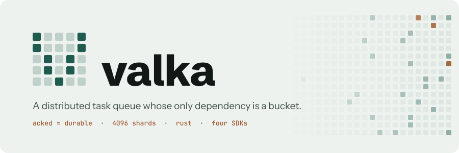

<p align="center">
  <picture>
    <source media="(prefers-color-scheme: dark)" srcset="assets/brand/banner-dark.svg">
    
  </picture>
</p>

<p align="center">
  <strong>A Rust-native distributed task queue with a write-ahead log on object storage.</strong><br/>
  One bucket. Zero databases. Zero brokers. Nodes you can kill.
</p>

<p align="center">
  <a href="#quick-start">Quick Start</a> &bull;
  <a href="#sdks">SDKs</a> &bull;
  <a href="#architecture">Architecture</a> &bull;
  <a href="#web-dashboard">Dashboard</a> &bull;
  <a href="#deployment">Deployment</a>
</p>

<p align="center">
  
</p>

---

## Why Valka?

Most task queues bolt together a message broker, a database, and a cache. Every moving part is another thing to deploy, monitor, and debug at 3 AM.

**Valka takes a different approach.** An S3-compatible bucket is the single source of truth: every state transition is appended to a write-ahead log, group-committed to the bucket, and nothing is acknowledged before it lands there. Nodes hold only rebuildable RAM state, so any node can be killed at any time and a fresh one rebuilds itself from snapshots plus the WAL tail. An in-memory matching engine and gRPC bidirectional streaming replace the message broker entirely.

- **One dependency.** If you have a bucket (S3, MinIO, R2, or a local directory), you can run Valka.
- **Diskless, disposable nodes.** Acknowledged means durable in the bucket (on S3, eleven nines), with no replication to operate.
- **Free history and CDC.** The WAL is plain zstd-compressed JSON; anything can tail it straight from the bucket.
- **In-memory hot path.** A task reaches a waiting worker the moment it is durable, with no polling: pickup is the commit latency plus about a millisecond ([benchmarks](docs/BENCHMARKS.md)).
- **Polyglot.** Rust, TypeScript, Go, and Python SDKs. Or just use the REST API.
- **Observable.** Real-time log streaming, event feeds, Prometheus metrics, and a web dashboard out of the box.

## Features

- Write-ahead log on object storage: group commit, per-shard snapshots, exact replay
- In-memory task matching fed from a RAM pending index (no polling, no DB on the hot path)
- gRPC bidirectional streaming (single connection per worker, no polling)
- Run one node or many on the same bucket: any node takes any request, workers on any node run any task, a dead node's work moves to the others in ~15 s with nothing acknowledged lost
- Single-writer shards (default 4096) fenced by leases and CAS'd owner records; queue partitions spread a queue over nodes
- Workers ride through node failures: they reconnect anywhere and reattach their running tasks
- Task signals — send real-time signals to running workers
- Step checkpoints — a failed task retries from the last completed step, not from scratch
- Results acknowledged end to end — workers keep a result until it is recorded, and ride through server restarts
- Automatic retries with exponential backoff + dead letter queue
- Structured log streaming per task run
- Event broadcasting via gRPC streams and SSE
- Idempotency keys (a repeated create returns the first task), task cancellation, scheduled/delayed tasks
- Producers ride through failures too: SDK clients take every node's address, retry on the next node, and attach an idempotency key so a retry never makes a second task
- API keys for the public API, a separate admin token for cluster changes
- Backpressure: a per-node limit on tasks in RAM (HTTP 429 / RESOURCE_EXHAUSTED) and on payload size
- Web dashboard (with an Operations page for drains, shard moves and queue partitions), CLI, and Prometheus metrics
- Graceful shutdown for both server and workers

## Quick Start

```bash
# 1. Start the server against a local directory (./data). No services needed.
cargo run -p valka-server

#    ...or against MinIO (S3-compatible):
#    docker compose up -d minio minio-init
#    VALKA_STORAGE__BACKEND=s3 VALKA_STORAGE__BUCKET=valka \
#    VALKA_STORAGE__ENDPOINT=http://localhost:9000 VALKA_STORAGE__ALLOW_HTTP=true \
#    VALKA_STORAGE__ACCESS_KEY_ID=minioadmin VALKA_STORAGE__SECRET_ACCESS_KEY=minioadmin \
#    cargo run -p valka-server

# 3. Run a worker
cargo run -p valka-examples --example worker

# 4. Create tasks
cargo run -p valka-examples --example producer
```

The server starts on **gRPC `:50051`** and **REST `:8989`**.

## SDKs

| Language | Package | Install |
|----------|---------|---------|
| **Rust** | `valka-sdk` | `cargo add valka-sdk --git https://github.com/IWhitebird/Valka` |
| **TypeScript** | `@valka/sdk` | `npm install https://github.com/IWhitebird/Valka/releases/download/v0.2.0/valka-sdk-0.2.0.tgz` |
| **Go** | `github.com/IWhitebird/Valka/sdks/go` | `go get github.com/IWhitebird/Valka/sdks/go` |
| **Python** | `valka` | `pip install "git+https://github.com/IWhitebird/Valka@v0.2.0#subdirectory=sdks/python"` |

Any language can also interact via the REST API.

### Rust

```rust
let worker = ValkaWorker::builder()
    .name("email-worker")
    // Every node of the cluster: the worker moves on if its node goes away.
    .server_addrs(&["http://valka-1:50051", "http://valka-2:50051"])
    .api_key("…") // or VALKA_API_KEY
    .queues(&["emails"])
    .concurrency(8)
    .handler(|ctx: TaskContext| async move {
        let input: serde_json::Value = ctx.input()?;
        // ... do work ...
        Ok(serde_json::json!({"status": "delivered"}))
    })
    .build()
    .await?;

worker.run().await
```

### TypeScript

```typescript
const worker = new ValkaWorker({
  name: "email-worker",
  serverAddr: "localhost:50051",
  queues: ["emails"],
  concurrency: 8,
  handler: async (ctx) => {
    console.log(`Processing: ${ctx.taskName}`);
    return { status: "delivered" };
  },
});
await worker.run();
```

### Step checkpoints

A handler can split its work into named steps. Each step's result is written to the WAL
before the step returns, and every retry of the task (after a failure, a lease expiry, or
a node crash) receives the recorded results, so completed steps are skipped:

```rust
.handler(|ctx: TaskContext| async move {
    let rows: Vec<Row> = ctx.step("fetch", || fetch_rows()).await?;
    let report: Report = ctx.step("transform", || build_report(&rows)).await?;
    ctx.step("upload", || upload(&report)).await?;
    Ok(serde_json::json!({"rows": rows.len()}))
})
```

The same API exists in every SDK: `ctx.step(name, fn)` in TypeScript and Python,
`valka.Step(ctx, name, fn)` in Go. A step that fails before its checkpoint is recorded runs
again, so steps with external side effects should still be idempotent. Checkpoints are
visible at `GET /api/v1/tasks/{id}/checkpoints` and on the task page. Runnable examples:
`examples/{rs,typescript,go,python}` (`steps`).

## Architecture

```
  producers (REST / gRPC / CLI)                      workers (Rust, Go, Python, TS)
          │                                                │ one gRPC stream each, any node
          ▼                                                ▼
 ┌──────── node A ─────────┐  internal gRPC   ┌──────── node B ─────────┐
 │ API: run here / forward │◄────────────────►│ API: run here / forward │
 │ shards A owns, in RAM   │  (token, mTLS)   │ shards B owns, in RAM   │
 │ timers, pending index   │                  │ timers, pending index   │
 │ WAL writer (group commit│                  │ WAL writer              │
 └───────────┬─────────────┘                  └───────────┬─────────────┘
             │ segments, snapshots, CAS on leases / owner records
             ▼                                            ▼
 ┌──────────────────────────── bucket: the only truth ───────────────────────────┐
 │ nodes/{node}/lease   owners/{hh}/{shard}   wal/{node}/{inc}-{seq}.seg          │
 │ snapshots/{hh}/{shard}/…   splits/…   queues/…   logs/…   cluster.json         │
 └───────────────────────────────────────────────────────────────────────────────┘
```

- Every change is a record in a WAL segment; nothing is acknowledged before its segment is
  in the bucket and the node has re-checked its own lease.
- Each shard has exactly one owner at a time. Owners renew a lease in the bucket every 2 s;
  a node whose lease stops changing for 10 s is declared dead by another node, its log is
  split into per-shard snapshots, and its shards are claimed by the others.
- One node is a cluster of one: the same protocol, no special case.

**Read [`docs/ARCHITECTURE.md`](docs/ARCHITECTURE.md)** for the full picture: life of a
task, the ownership protocol, failure walkthroughs, guarantees, and a comparison with
Cloudflare Durable Objects. Specs: [`DESIGN.md`](docs/wal/DESIGN.md) (one node),
[`PHASE2.md`](docs/wal/PHASE2.md) (many nodes). Operations:
[`RUNBOOKS.md`](docs/wal/RUNBOOKS.md).

### Task Lifecycle

```
PENDING ──► RUNNING ──┬──► COMPLETED
                      ├──► FAILED
                      └──► RETRY ──┬──► PENDING (after backoff)
                                   └──► DEAD_LETTER (out of attempts)
CANCELLED (via API, from any non-terminal state)
```

## Web Dashboard

Valka ships with a built-in React dashboard at the root path.

```bash
cd web && npm install && npm run dev  # Dev server on :5173
```

Pages: Dashboard, Tasks, Task Detail (runs, logs, signals, steps), Workers, Cluster (nodes, WAL health, shard map, storage), Events, Dead Letters.

## Deployment

### Docker Compose (recommended)

```bash
docker compose up
```

Starts an S3-compatible store + one Valka server. REST + Dashboard on `:8989`, gRPC on `:50051`, store console on `:9001`.
For production, point `[storage]` at a real bucket and drop the store services.

### A three-node cluster

```bash
docker compose -f docker-compose.cluster.yml up -d --build
```

REST and the dashboard on `:8981`, `:8982`, `:8983`; gRPC on `:50061`–`:50063`. Any node
takes any request. Watch a takeover on the Cluster page while you
`docker compose -f docker-compose.cluster.yml kill -s SIGKILL valka-2`.

`scripts/chaos.sh` runs a chaos test against it: random `kill -9`, freezes and restarts
under load, then checks that every acknowledged task exists and finished.

A cluster needs an S3-compatible bucket (the local-directory backend is single-node only),
`VALKA_CLUSTER__ENABLED=true`, the same `VALKA_CLUSTER__TOKEN` on every node, a distinct
`VALKA_NODE_ID` per node, and the internal port (`:50052`) reachable between nodes.

### From Source

```bash
cargo build --release --workspace
./target/release/valka-server
```

### Configuration

Layered via [figment](https://github.com/SergioBenitez/Figment): defaults → `valka.toml` → env vars.

| Variable | Default | Description |
|----------|---------|-------------|
| `VALKA_STORAGE__BACKEND` | `local` | `s3`, `local` (directory), or `memory` |
| `VALKA_STORAGE__PATH` | `./data` | Directory for the `local` backend |
| `VALKA_STORAGE__BUCKET` | `valka` | Bucket for the `s3` backend |
| `VALKA_STORAGE__ENDPOINT` | — | Custom S3 endpoint (MinIO, R2). Omit for AWS |
| `VALKA_NODE_ID` | host name | Stable node id; a restart splits what the previous run left, so its shards are served again at once |
| `VALKA_CLUSTER__ENABLED` | `false` | Allow several nodes on one bucket (S3 backends only) |
| `VALKA_CLUSTER__TOKEN` | — | Shared secret for node-to-node calls (required when clustered) |
| `VALKA_CLUSTER__INTERNAL_ADDR` | `0.0.0.0:50052` | Node-to-node listener (never expose publicly) |
| `VALKA_CLUSTER__ADVERTISE_INTERNAL_ADDR` | internal addr | Address peers use to reach this node |
| `VALKA_CLUSTER__NUM_SHARDS` | `4096` | Shard count of a new bucket (fixed afterwards) |
| `VALKA_ADMIN_TOKEN` | — | Enables the admin API (drain node, move shard, queue partitions) |
| `VALKA_API_KEYS` | — | Comma-separated API keys for the public REST and gRPC APIs (unset: open, with a warning) |
| `VALKA_LIMITS__MAX_TASKS_IN_RAM` | `1000000` | Tasks a node holds in RAM before creates get 429 |
| `VALKA_LIMITS__MAX_PAYLOAD_BYTES` | `1048576` | Largest task input or metadata |
| `VALKA_WAL__FLUSH_INTERVAL_MS` | `50` | Group-commit window (enqueue ack latency) |
| `VALKA_GRPC_ADDR` | `0.0.0.0:50051` | gRPC listen address |
| `VALKA_HTTP_ADDR` | `0.0.0.0:8989` | REST/HTTP listen address |
| `RUST_LOG` | `valka=info,tower_http=info` | Log level filter |

## Roadmap

### Done

- [x] Core task queue with retry and dead letter queue
- [x] gRPC bidirectional streaming workers
- [x] REST API + CLI + Web dashboard
- [x] Real-time event and log streaming
- [x] Task signals (send signals to running workers)
- [x] Step checkpoints (retries resume after the last completed step)
- [x] Polyglot SDKs — Rust, TypeScript, Go, Python
- [x] Object-storage WAL: diskless nodes, snapshots, exact replay, fault-injected tests
- [x] Many nodes on one bucket: leases, owner records, log splitting, placement, routing, cross-node workers, worker reattach, admin API (TLA+-checked protocol, randomized simulation, chaos rig)

### Up Next

- [ ] Helm chart and systemd units
- [ ] Network-split chaos and a 24 h soak
- [ ] Task priorities and weighted fair queuing
- [ ] Cron / recurring task scheduling
- [ ] Rate limiting per queue
- [ ] Task batching

## License

Apache License 2.0 — see [LICENSE](LICENSE) for details.
